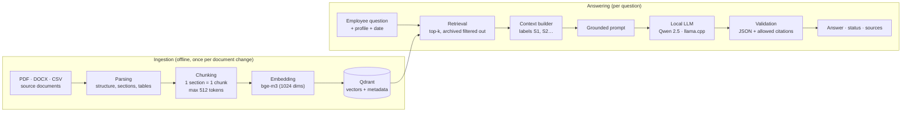

# PeopleKnowledge AI

**A grounded HR assistant built on Retrieval-Augmented Generation (RAG).** Employees ask their HR questions in plain language and receive a short answer, the exact policy sections it comes from, and an honest *"not found"* when the documents do not say.

The whole system runs **locally and free of charge**: local embeddings (`BAAI/bge-m3`), a local vector database (Qdrant) and a local language model (Qwen 2.5 served by `llama.cpp`). No document ever leaves the machine.


> **Fictional data.** Every document describes *NovaTech Solutions*, an invented company (Tunis, 150 employees, 5 departments). The documents carry the mention *"Document fictif"* and are not a statement of Tunisian labour law. No real personal data is used.

---

## Table of contents

- [Why this project](#why-this-project)
- [What it can do](#what-it-can-do)
- [How it works](#how-it-works)
- [A corpus designed to be difficult](#a-corpus-designed-to-be-difficult)
- [Evaluation and results](#evaluation-and-results)
- [Tech stack](#tech-stack)
- [Project structure](#project-structure)
- [Getting started](#getting-started)
- [API](#api)
- [Key design decisions](#key-design-decisions)
- [Roadmap](#roadmap)

---

## Why this project

HR questions look simple ("How many days of leave can I take during my probation?"), but the answer is often spread across several documents, depends on who is asking, and changes when a policy is revised. A plain chatbot invents a plausible number; a plain search engine returns ten pages to read.

PeopleKnowledge AI aims at the middle ground a real company needs:

- answers that are **short and direct**, in the employee's language;
- every answer **traceable** to a document, a version and a section;
- the **current** policy applied, never an archived one;
- the **specific rule** (an exception, a department-specific row) preferred over the general one;
- an explicit **"I could not find it"** instead of a guess.

The project is also a learning ground for building RAG *properly*: measured with a hand-written test set rather than judged on a few demos.

## What it can do

| Capability | Details |
|---|---|
| **Answer HR questions with sources** | `POST /api/answer` retrieves the relevant sections, asks the local model for a grounded answer and returns it with the cited documents (id, version, section). |
| **Refuse to guess** | Every answer has a status: `complete`, `partial` (some detail is missing or a profile attribute is unknown) or `not_found`. |
| **Trusted citations** | Sources are given to the model as short labels (`S1`, `S2`…). The model may only cite labels it actually received; any other label is rejected, and the application maps labels back to the real documents itself. |
| **Version awareness** | Archived policies are excluded by default and only used for historical questions. Each source shows its validity dates and what replaced it. |
| **Profile-aware answers** | The employee's context (department, job family, contract type, probation, seniority) is passed explicitly; the model is told never to infer a missing value. |
| **Semantic search** | `POST /api/search` returns the closest chunks with their scores, for inspection and debugging. |
| **Built-in test page** | A web page at `/` to ask a free question or pick one of the 32 gold questions, then compare the generated answer, the expected answer and the retrieved evidence. |
| **Measurable quality** | Scripts compute retrieval metrics (hit@k, MRR, useful@k, forbidden sources) on the gold questions. |

## How it works

The pipeline has two halves: an **offline ingestion** that prepares the documents once, and an **online path** that runs for every question.



| Stage | What happens | Where |
|---|---|---|
| **Catalog & manifest** | Each document has a hand-written catalog entry (id, version, validity, lifecycle). A script scans the files (SHA-256, renames, duplicates) and merges the catalog into a manifest. | `scripts/build_manifest.py` |
| **Parsing** | Format-specific parsers produce one common structure: headings, paragraphs, lists, tables, CSV records, each with its section path. Running headers/footers are removed and tables split by page breaks are joined. Parsers contain no corpus-specific rule. | `src/peopleknowledge/ingestion/parsers/` |
| **Chunking** | One chunk per section, prefixed with a breadcrumb (`HR-005 v1.2 — Leave policy > 4. Probation > 4.2 Exception`) so that short rules keep their context. Long sections are split between elements, then table rows, then sentences, never inside one. All document metadata is copied to each chunk. | `src/peopleknowledge/ingestion/chunking/` |
| **Indexing** | Chunks are embedded with `bge-m3` and synchronised into Qdrant. Only new or changed chunks are re-encoded; removed ones are deleted. | `src/peopleknowledge/retrieval/` |
| **Generation** | Retrieved chunks become a labelled context; a stable system prompt sets the rules, a dynamic user message carries date, profile, sources and question. The answer is strict JSON. | `src/peopleknowledge/generation/` |
| **Evaluation** | Gold questions and metrics, independent of the model and the vector store. | `src/peopleknowledge/evaluation/` |

## A corpus designed to be difficult

The test corpus is small on purpose (6 documents, 187 chunks) but every document hides a trap a naive RAG system falls into:

| Document | Format | Trap it contains |
|---|---|---|
| HR-001 Employee handbook v3.0 | PDF, 11 p. | Gives the *general* rule, vaguely; the precise exception lives elsewhere. |
| HR-005 Annual leave policy v1.2 | PDF, 6 p. | §4.2: leave during probation limited to 2 days, the exception to the handbook. |
| HR-006 Leave request procedure v1.1 | DOCX | Procedure steps and tables in Word structure. |
| HR-011 Remote work policy v2.0 | PDF, 5 p. | Current rules, including a department-specific anchor day. |
| HR-013 Remote work eligibility matrix | CSV, 38 rows | Information that exists **only** in a table row (e.g. on-call constraints for SRE and support). |
| HR-029 Remote work policy v1.0 | PDF, **archived** | Contradicts v2.0: must never be used for a current question. |

The fictional rules and their figures are stored once, in `datasets/metadata/canonical_policy_rules.yaml`. That file is the answer key: it is **never indexed**, so it cannot leak into the answers and distort the measurements.

## Evaluation and results

**32 hand-written gold questions**, each with expected, acceptable and forbidden sources, cover eight categories: direct questions, varied vocabulary, CSV-only facts, version conflicts, exceptions stated elsewhere, history, multi-source and unanswerable questions.

### Retrieval baseline

`bge-m3`, 187 chunks, top 10, 30 answerable questions:

| Metric | Score | Meaning |
|---|---:|---|
| hit@1 | **63 %** | All expected sources are found at rank 1 |
| hit@3 | **80 %** | … within the first 3 results |
| hit@5 | **87 %** | … within the first 5 results |
| MRR | **0.777** | Average of 1 / rank of the expected source |
| useful@1 | **87 %** | The first result is an expected *or* acceptable source |
| Forbidden sources | **0** | No archived policy retrieved for a current question |

What the measurements taught:

- Most "not first" cases still have an *acceptable* source at rank 1 (a summary of the same rule).
- The 38 near-identical CSV rows crowd the results when a question names a department.
- With archived documents forced into the search, the old v1 policy reaches rank 2 on three version-conflict questions: **the lifecycle filter is necessary**, not cosmetic.
- Unanswerable questions score in the same range as answerable ones, so a similarity threshold cannot detect "no answer"; the generation prompt has to.

### Generation evaluation

Every generated answer is checked automatically, without an LLM judge (`src/peopleknowledge/evaluation/generation_eval.py`):

| Check | Needs a gold question | Pass condition |
|---|:---:|---|
| Status | yes | answerable → `complete` (`partial` = weak); unanswerable → never `complete` |
| Key facts | yes | every number of the question's `rule_refs` (in `canonical_policy_rules.yaml`) appears in the answer |
| Sources | yes | expected sources cited (recall), cited sources expected or acceptable (precision), no forbidden source |
| Unsupported numbers | no | every number of the answer is in the prompt (or is the sum of two of its numbers) |
| Prompt leak / repeated question | no | the answer is not text copied from the system prompt or the question |

Key facts are **derived** from `rule_refs`, not written by hand (`evaluation/key_facts.py`): a path can point to one list item (`annual_leave.notice_periods[2].notice_working_days`), document references (`HR-013`, `lot 2`) are ignored, and `validate_gold.py` fails when a gold answer does not contain all of its own key facts, so a too broad `rule_refs` is caught at once.

The checks run on **every answer of the web page** (generic checks for a free question, all checks for a gold scenario), and on the 32 questions with `scripts/evaluate_generation.py`, in two modes: `e2e` (through the running API) and `oracle` (the model receives the expected sources directly: it measures the generation alone, so a low e2e score with a good oracle score points to the retrieval).

## Tech stack

| Layer | Choice | Why |
|---|---|---|
| Language | Python 3.11+ | Ecosystem for NLP and ML |
| API | FastAPI, Pydantic v2 | Typed contracts between every stage |
| Parsing | pdfplumber, python-docx, csv | Layout-aware PDF extraction (fonts, tables) |
| Embeddings | `BAAI/bge-m3` via sentence-transformers | Free, local, strong on French, 8k-token input |
| Vector store | Qdrant (embedded mode) | Payload filtering; same code works with a Qdrant server |
| LLM | Qwen 2.5 1.5B Instruct via `llama.cpp` | Runs on a CPU laptop; OpenAI-compatible API |
| Quality | pytest (249 tests), ruff | Synthetic fixtures prove the parsers are generic |

## Project structure

```text
peopleknowledge-ai/
├── pyproject.toml              # dependencies + ruff / pytest configuration
├── src/peopleknowledge/        # the Python package, one folder per RAG phase
│   ├── config.py               # settings read from .env
│   ├── ingestion/              # parsers (PDF, DOCX, CSV) and chunking
│   ├── retrieval/              # embeddings and Qdrant index
│   ├── generation/             # context builder, prompt, LLM client
│   ├── evaluation/             # gold questions and metrics
│   └── api/                    # FastAPI endpoints and test page
├── scripts/                    # command-line runners of the pipeline
├── tests/                      # mirrors src/peopleknowledge/
├── datasets/
│   ├── source_documents/       # the corpus (kept local)
│   ├── metadata/               # company profile, policy rules, document catalog
│   └── evaluation/             # rag_questions_gold.jsonl
└── docs/                       # evaluation notes
```

## Getting started

> The source documents are kept out of the repository for now. The metadata, the gold questions and all the code are versioned.

### 1. Install

```powershell
py -3.11 -m venv .venv
.\.venv\Scripts\Activate.ps1
python -m pip install -e ".[dev]"
Copy-Item .env.example .env
```

The embedding model (`BAAI/bge-m3`, about 2.3 GB) is downloaded to the Hugging Face cache (`HF_HOME`) the first time the indexing script runs. The API itself never downloads a model (`HF_HUB_OFFLINE=true`).

### 2. Build the index

```powershell
python scripts/build_manifest.py     # inventory + catalog -> manifest
python scripts/parse_documents.py    # documents -> structured JSON
python scripts/chunk_documents.py    # structured JSON -> chunks
python scripts/index_chunks.py       # chunks -> embeddings -> Qdrant
```

Each runner only rewrites what changed and can be rerun safely.

### 3. Start the language model

Run a `llama.cpp` server with a Qwen 2.5 Instruct GGUF model, exposing the OpenAI-compatible API on `http://localhost:8080/v1` (configurable in `.env`). In a **separate terminal** (it must stay open):

```powershell
winget install ggml.llamacpp      # once
llama-server -hf Qwen/Qwen2.5-1.5B-Instruct-GGUF:Q4_K_M --port 8080 --alias qwen2.5-1.5b-instruct -c 8192
```

`-hf` downloads the model (about 1 GB) on the first run; with a local file use `-m C:\models\qwen2.5-1.5b-instruct-q4_k_m.gguf` instead. Ready when <http://localhost:8080/health> answers `{"status":"ok"}`. `-c 8192` leaves room for the long prompt (system rules + 10 passages).

### 4. Run the assistant

In a second terminal:

```powershell
python -m uvicorn peopleknowledge.api.main:app --port 8000
```

Open <http://localhost:8000> for the test page, or <http://localhost:8000/docs> for the interactive API documentation. If port 8000 is taken, use another one (`--port 8002`). Choose a scenario in "Question de référence" and ask it: the "Évaluation automatique" panel under the answer shows the checks. The first question takes about a minute (the embedding model loads), then each answer takes 10 to 60 s on a laptop CPU.

The local Qdrant index can be opened by one program at a time: stop the API before running `index_chunks.py` or `evaluate_retrieval.py` without `--api-url`.

### 5. Measure and test

```powershell
python scripts/validate_gold.py                       # check the gold questions against the corpus
python scripts/evaluate_retrieval.py --label baseline # retrieval metrics
python scripts/evaluate_generation.py --label baseline                      # generation, via the running API
python scripts/evaluate_generation.py --mode oracle --label baseline_oracle # generation alone (llama-server only)
python -m pytest                                      # 284 tests
python -m ruff check .
```

## API

| Method | Endpoint | Purpose |
|---|---|---|
| `GET` | `/health` | Liveness check |
| `GET` | `/` | Test page (French interface) |
| `POST` | `/api/answer` | Full RAG answer: status, text, cited sources, timings, retrieved chunks |
| `POST` | `/api/search` | Ranked chunks for a question |
| `GET` | `/api/gold` | The gold questions with their expected sources |
| `GET` | `/api/profile-options` | Valid profile values (departments, contracts…) |

Example request:

```json
POST /api/answer
{
  "question": "Puis-je poser des congés pendant ma période d'essai ?",
  "reference_date": "2026-11-04",
  "user_context": { "employment_type": "cdi", "in_probation": true },
  "limit": 5,
  "gold_id": "Q001"
}
```

`gold_id` is optional: with it, the `evaluation` field of the response compares the answer with that gold question; without it, only the generic checks run.

## Key design decisions

- **One section, one chunk.** Measured first: the median section is 92 tokens and only one exceeds 512. Policy rules stay whole instead of being cut at an arbitrary size.
- **The breadcrumb is embedded with the text.** A two-line exception means nothing alone; with its document and section titles it is retrievable.
- **Archived documents are indexed but filtered.** History questions still work, current ones never see old rules.
- **Generic parsers.** No company name, column name or font in the parser code; corpus conventions are configuration. Each layout rule is tested on synthetic documents that differ from the corpus.
- **Deterministic pipeline.** Same input, same output, byte for byte, so runners can rewrite only what changed.
- **Citations are validated, not trusted.** The model chooses among labels it was given; the application owns the mapping to real documents.
- **One source of truth per fact.** Entities in the company profile, rules in the canonical rules file, document identity in the catalog.

## Roadmap

- [x] Synthetic HR corpus with deliberate traps, catalog and manifest
- [x] Generic parsers (PDF, DOCX, CSV) and structure-aware chunking
- [x] Local embeddings and vector search with lifecycle filtering
- [x] 32 gold questions and retrieval baseline
- [x] Grounded generation with validated citations, API and test page
- [ ] Evaluate generation on the gold questions (correctness, status, citations, latency)
- [ ] Improve retrieval: hybrid keyword search, reranking, diversity for table rows
- [ ] Larger corpus: employee lifecycle, operations and security policies
- [ ] **Role-based access control** at retrieval time, for restricted documents
- [ ] Continuous integration (tests and lint on every push)
- [ ] Leave-management agent
